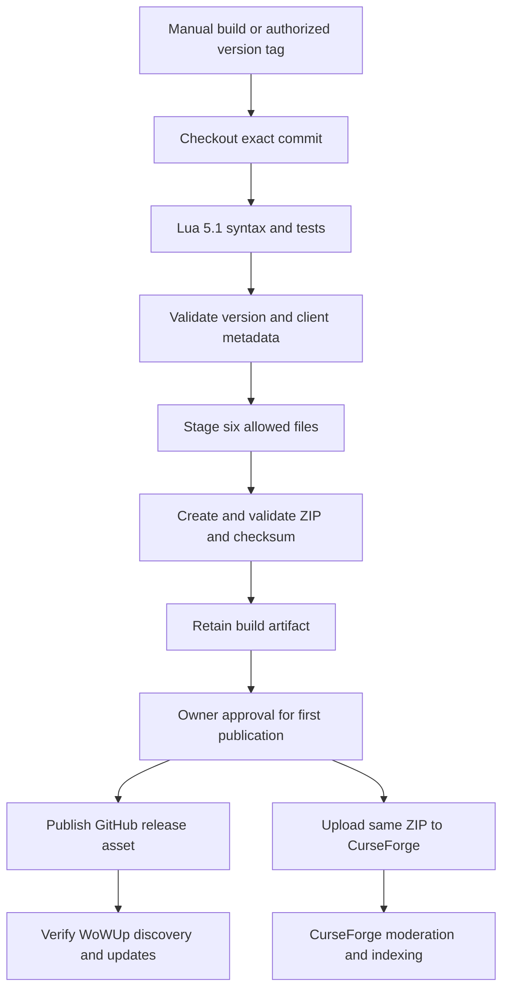

# Release plan

## Status and goal

The build helpers and `.github/workflows/release.yml` are installed in the
working tree. Publishing is **off by default**; repository/environment setup
and owner authorization are still required. This document records current
operation and setup, then retains the original design proposal for reference.
Updating it does not authorize a commit, tag, upload, or public release.

Publish one verified installable package to GitHub and CurseForge. Use the GitHub
release asset for WoWUp discovery and updates. Keep the AddOn runtime unchanged.

Current baseline:

- AddOn version: `0.1.0-beta`.
- Supported development target: Forever beta `1.60.1`, build `70338`,
  Interface `16001`, Lua `5.1`. The runtime requires that exact client build.
- Parent-reported local validation on **2026-10-13**: **270/270 Lua mock tests**
  and syntax checks for Commands.lua, Equipment.lua, Core.lua, UI.lua, and
  tests/run.lua passed on LF-normalized files. Runtime style and behavior are
  unchanged apart from LF normalization. Preserve the original 2026-10-12 Lua
  5.1.5 270/270 result in [TESTING.md](../TESTING.md) as historical evidence.
- Parent-reported local release-helper validation on **2026-10-13**: **62/62
  Python tests** (22 builder, 30 CurseForge, 10 provenance) and Python compilation
  passed under portable Python 3.13.7. **actionlint 1.7.12 passed silently** after
  the latest source-commit and tag-check workflow edits.
- No GitHub-hosted CI run or live-service upload has been tested. These local
  results do not establish remote publication, approval-gate enforcement, or
  full client compatibility.
- User-reported save/equip tests passed. Native combat macros work; WSF UI equips
  are out of combat only. Latest styled panels, restored combat guard, taint,
  ranged empties, ammo, and failure/isolation cases still need dedicated checks.
- MIT license and approved logo exports are present.
- The parent reports the local builder generated and validated the exact
  six-file `dist/WeaponSetsForever-0.1.0-beta.zip`; its recorded hash and
  provenance limits are below.
  Screenshots, clean ZIP client installation, required release-environment
  reviewers, publishing credentials/project IDs, and distribution support
  verification remain pending.
- The 2026-10-13 Git inspection found staged additions with unstaged changes,
  plus untracked release tooling/docs. Preserve staged user work and inspect
  current state before acting; do not stage or commit without authorization.
- `.gitattributes` specifies `* text=auto eol=lf` and binary PNG/JPG/JPEG/GIF/
  WebP/ZIP patterns. Working-tree text was normalized to LF with the index
  unchanged and the existing `core.autocrlf=input` setting preserved. `git ls-files --eol`
  confirms `i/lf w/lf` for tracked text. Do not renormalize the index or change
  global Git settings as part of documentation/release setup.

## Installed tooling and workflow

### Local build and tests (no publishing)

The release helpers and their unit tests use Python 3's standard library only;
none are AddOn runtime dependencies. From the repository root:

```sh
python3 scripts/build_release.py --output dist
python3 -m unittest discover -s tests -p 'test_*.py'
```

On this Windows checkout, use `.tools/python-3.13.7/python.exe` in place of
`python3`. This portable Python 3.13.7 came from a reviewed official `python.org`
embeddable archive under ignored `.tools/`, without an installer or PATH change.
The workflow uses `ubuntu-24.04`, native `python3`, and apt-installed `lua5.1`;
it cannot run the local Windows `.tools/` binaries.

Reviewed tooling sources for the reported local checks:

- Python 3.13.7: official
  [Windows embeddable archive](https://www.python.org/ftp/python/3.13.7/python-3.13.7-embed-amd64.zip).
- actionlint 1.7.12: official
  [v1.7.12 release](https://github.com/rhysd/actionlint/releases/tag/v1.7.12).

These are development tools under ignored `.tools/`, never runtime package files.

`scripts/build_release.py` uses an explicit six-file allowlist, validates the
TOC/version/license and actual archive, and writes:

- `dist/WeaponSetsForever-0.1.0-beta.zip` (name follows the TOC version);
- the adjacent `.zip.sha256` checksum;
- `dist/release-manifest.json`;
- `dist/release-notes.md`.

Only the six package files are inside the installable ZIP. Checksums, manifest,
and notes stay outside it. Identical inputs and toolchain produce deterministic
ZIP bytes; this is not a cross-toolchain compression guarantee. The builder does
not itself run Lua syntax checks or establish client compatibility.

A local build requires no CurseForge credentials, tag, or GitHub CLI login.
Optional `--tag` must match the TOC version; do not invent a release tag.
Optional `--source-commit` accepts a real full lowercase 40-character Git SHA and
records `source_commit` in the external manifest. CI supplies `GITHUB_SHA`.
This is caller-supplied provenance, not a commit derived from ZIP contents or
proof that a local working tree equals that commit. Omit it when not established.

**Parent-reported local artifact validation (2026-10-13):**

- Version: `0.1.0-beta`.
- Archive: `dist/WeaponSetsForever-0.1.0-beta.zip`, validated against the exact
  six-file package contract.
- SHA-256: `ccebf3646175de74b2ff27c7f497c33ac80f63fba2c584a009604e33ce4f74cf`.
- The local manifest omits `source_commit` because local `main` has no commits.
  CI supplies the actual `GITHUB_SHA` commit to `--source-commit`; no commit is
  derived from the ZIP. The local artifact is not a hosted-CI or upload test.

### CI and publication boundary

The installed workflow runs tests and builds on `main` pushes, pull requests,
manual dispatch, and `v*` tag pushes. Manual runs are build-only. Default
permissions are `contents: read`; build jobs receive no publisher secrets.
For tag builds, the Python builder validates the version against the TOC and
`git merge-base --is-ancestor HEAD origin/main` verifies source ancestry.
Publishers additionally require strict `vVERSION` tags matching the manifest.
A broad `v*` trigger alone is not version validation.

Checkout, artifact upload, and artifact download Actions are pinned to reviewed
full SHAs, reported verified against the GitHub API. Review future pin changes.
CI checks Lua 5.1 syntax/logic and Python tests, builds once, syntax-checks the
packaged Lua, and retains `installable-addon` artifacts for 30 days.

The `github-release` job requires a tag push and repository variable
`ENABLE_GITHUB_RELEASES` exactly `true`. It uses the `release` environment,
`contents: write`, built-in `GITHUB_TOKEN`, and GitHub CLI `gh` on the hosted
runner. Local `gh` authentication is not needed for CI. It refuses an existing
release, creates a draft with the tested ZIP/checksum/manifest, revalidates, then
makes the release public. Beta versions remain prereleases.

The `curseforge` job requires the GitHub publisher to succeed and **both**
`ENABLE_GITHUB_RELEASES` and `ENABLE_CURSEFORGE_UPLOADS` exactly `true`.
It also uses the `release` environment. Setting only the CurseForge flag cannot
publish. It requires positive decimal repository variables
`CURSEFORGE_PROJECT_ID` and `CURSEFORGE_GAME_VERSION_ID`, plus environment secret
`CF_API_TOKEN`. The uploader checks the server's selected game-version entry
for exact name `1.60.1` and Forever type `88568`; it never substitutes another
client/version. Redirects are refused and upload POSTs are never retried.
Only workflow attempt 1 may upload to CurseForge. A successful upload receipt
(`curseforge-upload.json`) is retained for 90 days; acceptance is not moderation
approval. Receipts are not distributed locks or proof that an unacknowledged
request failed.

`scripts/verify_release.py` revalidates the ZIP, manifest, checksum sidecar,
source commit against the workflow SHA, and the current remote tag. It handles
lightweight tags and peels annotated tags to a commit. The workflow invokes it
**before GitHub draft creation, again before public publication, and before
CurseForge upload**. Provenance and tag checks are separate from ZIP validation.
They are not atomic with publication: a tag can still move between a check and
an external operation. Immutable-tag protection is required, not optional proof
provided by these rechecks.

### Required setup before enabling publication

1. **Leave both opt-ins disabled.** In repository **Settings → Secrets and
   variables → Actions → Variables**, leave `ENABLE_GITHUB_RELEASES` and
   `ENABLE_CURSEFORGE_UPLOADS` absent or set them to `false` while preparing.
2. **Configure approvals first.** In **Settings → Environments**, create/select
   `release`, configure required reviewers under deployment protection rules,
   and prevent self-review/bypass where supported. Limit deployment tags to the
   intended release-tag pattern. Verify required reviewers are available for
   this repository/plan and that a job actually waits for approval before any
   publishing step. Merely declaring `environment: release` does **not** create
   required reviewers. If enforced approvals are unavailable, leave flags off
   until an agreed effective gate exists. Use a controlled no-upload gate check
   before enabling the installed publisher; ordinary build-only runs do not
   exercise its environment gate.
3. **Protect tags and source.** In **Settings → Rules → Rulesets**, create an
   active tag ruleset targeting `v*`: restrict creation to authorized maintainers
   and restrict updates and deletions. Minimize bypass permissions; never move
   or delete a released tag. Protect `main` through the repository's agreed
   review controls. Confirm rules actually apply before publication; ancestry
   and repeated API checks cannot eliminate a tag-movement race.
4. **Finish service setup.** Create/verify the CurseForge project and exact
   Forever `1.60.1` game-version ID/type `88568`. In repository Actions variables,
   set `CURSEFORGE_PROJECT_ID` and `CURSEFORGE_GAME_VERSION_ID` to the verified
   positive decimal IDs, not example values. In **Settings → Environments →
   release → Environment secrets**, add author upload token `CF_API_TOKEN`.
   Never put it in source, chat, a URL, or build-job configuration. GitHub
   publishing needs no separate personal token: `GITHUB_TOKEN` is built in.
5. **Verify the candidate.** Review/commit/push only when authorized, run the
   build-only workflow, inspect its inner ZIP and checksum/manifest, install that
   exact ZIP in a clean client folder, and complete the client checklist. Retain
   actual test results; expected totals are not passing evidence. Confirm public
   GitHub access and current CurseForge/WoWUp Forever and beta-channel support.
6. **Enable only intended destinations after gate verification.** Set repository
   variable `ENABLE_GITHUB_RELEASES` to literal `true` when approved. Set
   `ENABLE_CURSEFORGE_UPLOADS` to literal `true` only after its service setup is
   complete and GitHub publication is also enabled. Leave it false for a
   GitHub-only release. Neither a manual run nor a `main` push publishes.
7. **Publish an authorized immutable tag.** The tag must be exactly `v` plus the
   TOC version and point to the reviewed commit on `main` (or an ancestor).
   Push it only with authorization. Approve the environment jobs, inspect the
   public GitHub assets, then the CurseForge receipt/moderation state. Check
   WoWUp discovery rather than treating upload success as a client update.

Do not use a blind workflow rerun as a recovery procedure. See
[failures and retries](#site-updates-failures-and-retries) below.

## What automation can and cannot do

| Destination | Automated path | Limits |
| --- | --- | --- |
| GitHub | Create a release and attach the tested ZIP through Actions. | Publication needs repository permission and an approved version tag. |
| CurseForge | Upload a new file, changelog, release type, and supported game-version IDs through its Upload API. | The project must exist. Uploads can require moderation; acceptance is not immediate publication. |
| WoWUp | Make the installable ZIP available as a public GitHub release asset. | Verify current Forever and beta-channel support, repository discovery, and client update detection. No separate WoWUp upload token is established by its Hub guide. |
| Other sites | Add a publisher only when its Forever support and API have been verified. | Do not assume that packager support means every service supports the target client. |

An upload or new GitHub release makes an update available. It does not force an
update on players' computers. Discovery, caching, selected release channels,
moderation, and the user's manager settings control when an update appears.
Do not add a self-updater to the AddOn.

## First-release checklist

### Client and package checks

- [ ] Confirm the current client still reports `1.60.1`, build `70338`, Interface
      `16001`, and Lua `5.1`.
- [ ] Test the latest brown/gold panels, Save/Enter/Cancel/Escape, and layout at
      the supported UI scales.
- [ ] Verify the restored UI combat rejection gives clear `/equipset` guidance.
      Verify the native macro still swaps the same current sets in combat.
- [ ] Complete the remaining safety checks in [TESTING.md](../TESTING.md).
- [ ] Rerun the focused Lua 5.1 tests, syntax checks, Python release-helper tests,
      and actionlint for the authorized release commit; record actual results.
      The 2026-10-13 local checks above are not a hosted-CI release run.
- [ ] Install from the exact release ZIP into a clean AddOn folder and test it.
      Do not delete the player's native sets or use the old experimental sets.
- [ ] Record the release commit, client build, test results, and ZIP hash.

### Project pages

- [ ] Create the CurseForge project, choose MIT, and add the usage description.
- [ ] Confirm Forever `1.60.1` is available in the current file-version choices
      and API. Record the exact version ID and its Forever game-version type.
      Do not substitute Retail, Classic, a nearby version, or an untested build.
- [ ] Add the approved [512-pixel logo](../artwork/weapon-sets-forever-logo-512.png),
      repository link, and issue-tracker link.
- [ ] Choose relevant distribution categories. The TOC's `Equipment` category
      controls the in-game list, not the site's category.
- [ ] Capture the Character buttons, Save panel, and Equip list. Crop unrelated
      chat and player information. Screenshots are recommended, not a general
      CurseForge AddOn submission requirement.
- [ ] Set a GitHub social-preview image. WoWUp's Hub guide uses that image, with
      the author avatar as a fallback.
- [ ] Authenticate `gh` if local CLI release management is needed. Git SSH
      authentication and `gh auth login` are separate.
- [ ] Review the initial commit and push it when authorized. Confirm the GitHub
      repository and release asset are publicly accessible for WoWUp.

## Package contract

Current first-version filename: `WeaponSetsForever-0.1.0-beta.zip`.

The archive must contain exactly these files under one top-level folder:

```text
WeaponSetsForever/
    WeaponSetsForever.toc
    Commands.lua
    Equipment.lua
    Core.lua
    UI.lua
    LICENSE
```

The validator permits one optional empty root directory entry. Additional files
or directories are not permitted. Exclude
`.tools/`, `.git/`, `.github/`, `tests/`, `docs/`, `artwork/`, README, TESTING,
agent guidance, generated logs, and all credentials/player data.

Use an explicit file allowlist. Do not ZIP the checkout and maintain a growing
list of exclusions. Keep `LICENSE` in the package, but do not load it in the TOC.
Keep the built-in `INV_Sword_04` icon; the approved publishing logo is not a
runtime texture. Do not add runtime artwork as part of release automation.

Validate the actual archive, not only the staging folder:

1. Check CRC/integrity, non-empty files, and the exact file list.
2. Reject absolute paths, traversal paths, symlinks, and extra root folders.
3. Verify the TOC name, Interface `16001`, and Commands/Equipment/Core/UI load
   order. Every listed runtime file must exist inside the archive.
4. Verify the packaged version matches the selected tag, with one leading `v`
   removed. Verify the packaged MIT copyright/permission notice is intact.
5. Check the packaged Lua files with Lua 5.1 syntax validation.
6. Produce a SHA-256 checksum outside the installable ZIP.

GitHub source archives and GitHub Actions artifact-download wrappers are not
installable release assets. Publish the verified inner ZIP as the release asset.
Build it once and reuse the same bytes for each destination.

## Historical proposal: GitHub Actions design

The following retains the original proposal and alternatives, not pending
implementation instructions. The small allowlist builder and separate
publication jobs are now installed as described above; BigWigs was not selected.
Current workflow/setup details take precedence over this historical design.

Originally recommended sequence:



### Triggers and release channels

- Run read-only tests on ordinary pushes and pull requests. Never publish from
  a pull-request run, fork, or arbitrary branch push.
- Add a manual build-only path first. Its default must not upload anything.
- After the dry run succeeds, use version-tag pushes as the release trigger.
  A tag such as `v0.1.0-beta` should match TOC version `0.1.0-beta`.
- Validate the tag rather than trusting a broad `v*` trigger to imply a valid
  release. Treat manual inputs as data, not shell source.
- Mark beta tags as GitHub prereleases and CurseForge `beta` files. Do not mark
  them stable merely to make them appear in a manager's default channel.
- GitHub and CurseForge have separate release-channel rules. The CurseForge
  submission guide warns that beta-only projects may not sync normally to its
  app and that a Release file is needed for normal project syncing. Verify the
  actual behavior before promising discovery.
- Use one publication workflow with explicit jobs. A release created with
  `GITHUB_TOKEN` does not normally trigger a second `release` workflow. Do not
  rely on that chained event to perform the CurseForge upload.
- Avoid using both tag-push and release-published triggers for the same upload.
  Otherwise one version can be published twice.

### Permissions, approvals, and secrets

- Give test/build jobs only `contents: read` and no publisher secrets.
- Give the GitHub publication job `contents: write`. Use the workflow's
  `GITHUB_TOKEN`; a personal token is not needed for that repository's release.
- Store the CurseForge Upload API token as a GitHub secret named `CF_API_TOKEN`.
  It is an author upload token, not an unrelated catalog API key. Send it in the
  `X-Api-Token` header, never in a URL or source file.
- Store the project ID and validated game-version ID as non-secret configuration.
  No project ID or usable publisher credential has been supplied yet.
- Gate the first publication with an approved release environment where the
  repository's GitHub plan permits it. Confirm protection rules actually exist;
  declaring an environment alone does not configure required reviewers.
- Pin Actions to reviewed full commit SHAs. Review scripts called by those
  Actions as well as their top-level YAML. Do not use mutable branches as pins.
- Restrict tag creation/publication to maintainers. Serialize publication per
  version; do not cancel a publisher midway through an upload.
- Never expose publication secrets to untrusted pull-request code.
- GitHub-hosted runners and external upload APIs involve network access. Check
  Actions quotas/billing and service rate limits before enabling repeated runs.

### Implementation options

**Recommended first implementation: a small allowlist ZIP builder plus separate
publication jobs.** This AddOn has only six distribution files. Use a Linux
runner, install or obtain Lua 5.1 through reviewed tooling, run the existing
suite, build the archive, and retain it as an artifact. Publish the tested bytes
through GitHub CLI and the documented CurseForge Upload API after approval.
A Linux runner cannot use the locally ignored Windows `.tools/` executables.

CurseForge's Upload API accepts multipart `metadata` and `file` fields. Metadata
includes `gameVersions`, `releaseType`, and `changelog`/`changelogType`. Record the
returned file ID and distinguish successful upload from moderator approval.

**Alternative: BigWigsMods/packager.** Its reviewed source supports Forever,
Interface `16xxx`, version-tag channels, GitHub releases, CurseForge uploads,
and a `release.json` asset with client metadata. It is a useful standard tool,
not an AddOn runtime dependency. Its behavior needs controls for this project:

- `.pkgmeta` can set `package-as: WeaponSetsForever` and exclude development
  material. Exclusions alone are not our package allowlist; validate the ZIP.
- Its default changelog generation creates `CHANGELOG.md` inside the package.
  That violates the six-file contract. A manual changelog outside the package,
  ignored from packaging, or another reviewed configuration must prevent it.
- Its CurseForge uploader can fall back to another game version when an exact
  match is absent. Our workflow must fail before publishing if Forever `1.60.1`
  is unavailable. A warning and a nearby version are not acceptable.
- Package in no-upload mode (`-d`) before examining artifacts. Do not provide
  upload secrets to a combined packaging step that can publish before validation.
- Decide how a later upload consumes the already verified archive. Do not silently
  rebuild a different ZIP between validation and publication.
- The composite Action reads `CF_API_TOKEN` for CurseForge and `GH_API_TOKEN` for
  GitHub. If selected, map `GH_API_TOKEN` to the job's `GITHUB_TOKEN`, not a new
  broad personal token.
- The reviewed upstream uploader does not support Forever uploads to
  WoWInterface. Do not enable that destination based only on the tool's name.

Reviewed upstream commit: `0f24d2169de3ceb3b79a981311b2ebab4c6160c7`.
The upstream Action, setup script, and release script were consulted during the
proposal review. No **BigWigs packager** Action is installed in this repository;
our custom workflow is installed. Reconfirm this alternative's behavior if it is
selected in the future.

## Site updates, failures, and retries

- A new approved CurseForge file updates that project's available versions.
- A public GitHub release asset gives WoWUp's GitHub provider an update source.
  Its Hub guide does not specify a guaranteed indexing time or a universal
  refresh webhook. Verify repository discovery, Forever detection, and beta
  subscription in the actual app. Do not invent a notification API.
- The game must not be modified while running merely because CI published a ZIP.
  Installation is the manager/user's responsibility.
- GitHub publication and a CurseForge upload are not one atomic operation. Report
  each destination separately and retain the tested artifact if one fails.
- Record tag, commit, ZIP hash, GitHub release/asset identifiers, CurseForge file
  ID, and moderation status. Use those records before retrying a failed run.
- Do not blindly repeat a timed-out upload. It may have created a file even when
  the client received no response. Check for an existing matching file first.
  Preserve the original build artifact, logs, hash, manifest, and any receipt.
- If GitHub failed after draft creation, inspect that draft and its uploaded
  assets and reverify the immutable tag/commit before any authorized manual
  completion. The installed job refuses an existing release; rerunning it is
  not a draft-recovery or replacement mechanism.
- If GitHub succeeded but CurseForge failed or timed out, retain the GitHub
  release and inspect the CurseForge dashboard and receipt for acceptance and
  moderation. The workflow blocks CurseForge on attempts greater than 1; do not
  bypass that guard or create another run merely to repeat an uncertain POST.
  Only consider an explicitly reviewed destination-specific recovery after
  establishing that no file was accepted and rechecking provenance/version.
- If a tag/provenance check fails, stop. Do not move the tag or replace assets
  to force a match. Review the cause; use a new version/tag for corrected code.
- To halt future publishing while investigating, set the relevant repository
  opt-in(s) to `false`. This does not roll back an accepted upload or guarantee
  that an already-running publisher stops; inspect remote state.
- Do not delete approved files or move a published tag to fix an error. Correct
  the source and publish a new version, or use a deliberately reviewed retry for
  a destination that never received the original file.

## First release and subsequent releases

### First release

1. Complete the required setup above with both publishing flags off.
2. Review/commit/push only when authorized. Local GitHub CLI authentication is
   needed only for local CLI management, not the hosted CI publisher.
3. Run the installed build-only workflow and confirm actual checks completed.
4. Inspect its ZIP and install that artifact in the beta client.
5. Verify required reviewers/tag protections and service configuration before
   enabling the intended repository flags.
6. Push the approved immutable version tag and approve the environment jobs.
7. Check CurseForge moderation, public GitHub asset access, and WoWUp installation.
8. Verify the manager detects a later beta version before promising automatic
   update availability.

### Later releases

1. Update code, TOC version, release notes, and actual client-test records.
2. Review and commit the change.
3. Push the authorized version tag.
4. Let CI test, package, validate, and publish to the enabled destinations.
5. Check each upload and manager-facing result. Keep moderation and client update
   behavior separate from CI success.

Every release note must state beta-only compatibility, out-of-combat WSF UI
equips, native combat macro use, and the need to re-save early experimental sets.
Do not claim support beyond the tested build, even if a site lists a broader
version label.

## Original implementation decisions and remaining setup

This checklist retains the proposal's choices while distinguishing installed
components from owner setup still pending.

- [x] Select the small ZIP builder/API jobs; these are now installed, not BigWigs.
- [ ] Confirm the CurseForge project ID, exact supported version ID, and upload API
      access. Set secrets in GitHub, not in chat or repository files.
- [ ] Confirm public repository access and current WoWUp Forever/prerelease support.
- [x] Install full-SHA-pinned checkout/artifact Actions (pins reported verified
      via GitHub API), hosted `gh`, and apt Lua 5.1 on `ubuntu-24.04`.
- [ ] Configure and verify `release` required reviewers and immutable tag rules
      before enabling either publisher flag. Decide the approval policy for later
      releases; the installed jobs continue to use the same environment.

## References

- [Project usage and current state](../README.md)
- [Test evidence and client checklist](../TESTING.md)
- [Artwork exports](../artwork/README.md)
- [CurseForge submission guide](https://support.curseforge.com/en/support/solutions/articles/9000197241-project-submission-guide)
- [CurseForge Upload API](https://support.curseforge.com/en/support/solutions/articles/9000197321-curseforge-upload-api)
- [WoWUp Hub guidance](https://wowup.io/guide/wowup/hub)
- [GitHub workflow triggers and token event behavior](https://docs.github.com/en/actions/how-tos/write-workflows/choose-when-workflows-run/trigger-a-workflow)
- [Reviewed BigWigs Action](https://github.com/BigWigsMods/packager/blob/0f24d2169de3ceb3b79a981311b2ebab4c6160c7/action.yml)
- [Reviewed BigWigs release script](https://github.com/BigWigsMods/packager/blob/0f24d2169de3ceb3b79a981311b2ebab4c6160c7/release.sh)
- [Reviewed BigWigs setup script](https://github.com/BigWigsMods/packager/blob/0f24d2169de3ceb3b79a981311b2ebab4c6160c7/setup-packager.sh)
